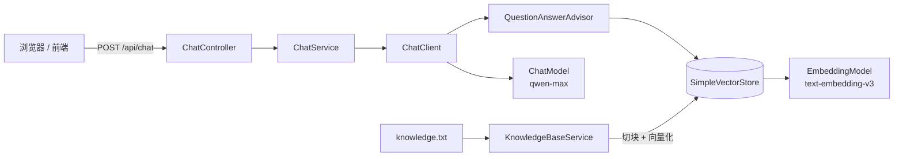

# rag-demo · RAG 全栈学习项目

一个用于系统学习「Java 全栈 + AI 应用开发」的实战项目：
把公司制度文档变成可问答的知识库，前端聊天、后端检索增强（RAG）、逐步演进为可上线的全栈应用。

> 这是学习项目，每一步都在真实提交中推进，进度见下方「学习路线」。

## 技术栈


- **后端**：Java 17 · Spring Boot 3.5 · Spring AI 1.0（OpenAI 兼容协议）
- **AI 模型**：通义千问 `qwen-max`（对话） + `text-embedding-v3`（向量化）
- **向量库**：SimpleVectorStore（本地 JSON 持久化，学习阶段用）
- **前端**：原生 HTML/JS（当前） → Vue 3 + Vite（规划中）

## 功能

- [x] 文档切块 + 向量化 + 本地持久化（重启不重复 embedding）
- [x] RAG 检索增强问答（`QuestionAnswerAdvisor`）
- [x] 统一响应体 + 全局异常处理 + 参数校验
- [x] 后端分层（Controller / Service / Config / DTO）
- [ ] 多轮对话记忆 + 流式输出（SSE）
- [ ] 文档上传与管理（PDF/Word/Markdown）
- [ ] 用户登录 + JWT 鉴权
- [ ] 会话/知识库落库（MySQL + Redis）
- [ ] Vue 3 前端工程
- [ ] Docker 部署 + CI

## 架构



请求链路：`Controller` 收参数 → `Service` 调模型 → `Advisor` 检索知识库并拼进 prompt → 模型生成回答 → 统一包装成 `{code, message, data}` 返回。

## 快速开始

### 1. 环境要求

| 依赖             | 版本                                                         |
| ---------------- | ------------------------------------------------------------ |
| JDK              | 17+                                                          |
| Maven            | 3.9+（或用自带的 `mvnw`）                                    |
| 通义千问 API Key | 在[阿里云百炼控制台](https://bailian.console.aliyun.com/)申请 |

### 2. 配置 API Key（三选一，**不要把 key 提交到仓库**）

**方式 A：环境变量（推荐）**

```properties
# application.properties 里只留占位符
spring.ai.openai.api-key=${OPENAI_API_KEY}
```
然后设置环境变量：

```bash
# Linux / macOS / Git Bash
export OPENAI_API_KEY=sk-xxxx

# Windows PowerShell
$env:OPENAI_API_KEY = "sk-xxxx"
```

**方式 B：本地配置文件**

复制 `config.properties.example` 为 `config.properties`，填入真实 key。该文件已被 `.gitignore` 忽略。

**方式 C：IDE 运行配置**

IDEA → Run/Debug Configurations → Environment variables 里填 `OPENAI_API_KEY=sk-xxxx`。

### 3. 启动

```bash
# 方式一：Maven Wrapper（无需本地装 Maven）
./mvnw spring-boot:run

# 方式二：打包后运行
./mvnw clean package -DskipTests
java -jar target/rag-demo-0.0.1-SNAPSHOT.jar
```

启动成功后访问 http://localhost:8080/。

## 接口

### POST /api/chat

请求：

```json
{
  "message": "住宿标准是多少"
}
```

响应：

```json
{
  "code": 0,
  "message": "ok",
  "data": "一线城市每晚不超过 500 元，二线城市每晚不超过 350 元。"
}
```

错误响应（参数校验失败）：

```json
{
  "code": 400,
  "message": "message: message 不能为空",
  "data": null
}
```

状态码约定：

| 状态码 | 含义                    |
| ------ | ----------------------- |
| 200    | 成功                    |
| 400    | 参数错误 / 业务校验失败 |
| 404    | 接口不存在              |
| 405    | 请求方法不支持          |
| 415    | Content-Type 不支持     |
| 500    | 服务端未预期异常        |
| 502    | 调用大模型失败          |

### GET /chat（兼容旧版，后续移除）

`GET /chat?message=xxx`，返回纯文本。

## 项目结构

```代码块
src/main/java/com/example/rag/demo/
├── common/          # 统一响应体、业务异常、全局异常处理
├── config/          # AI 相关 Bean 装配
├── controller/      # HTTP 层：收参数、返回 Result
├── dto/             # 请求/响应数据结构
└── service/         # 业务层：知识库初始化、模型调用
src/main/resources/
├── application.properties   # 通用配置（不含密钥）
├── knowledge.txt            # 示例知识库文档
└── static/index.html        # 临时聊天页面（后续由 Vue 替代）
```

## 学习路线

| 阶段 | 内容                                          | 状态 |
| ---- | --------------------------------------------- | ---- |
| 0    | 安全基线：密钥隔离、仓库清理、.gitignore      | ✅    |
| 1    | 后端分层 + 统一响应 + 全局异常 + 依赖版本对齐 | ✅    |
| 2    | README + 前端工程化（Vue 3）                  | 🚧    |
| 3    | MySQL / Redis 持久化                          | ⬜    |
| 4    | RAG 工程化：流式输出、文档上传、检索调优      | ⬜    |
| 5    | 鉴权 / 联调 / 接口文档                        | ⬜    |
| 6    | Agent / 工具调用                              | ⬜    |
| 7    | 部署上线 + CI/CD                              | ⬜    |

## 常见问题

**Q：启动报 `Could not resolve placeholder 'OPENAI_API_KEY'`** A：没有配置 API Key。按上面「配置 API Key」任选一种方式设置。

**Q：启动报 `知识库初始化失败`** A：检查 `src/main/resources/knowledge.txt` 是否存在、API Key 是否有效、`base-url` 是否可访问。

**Q：第一次启动很慢** A：首次启动要对文档做 embedding（网络请求），之后会从 `rag-verctor-store.json` 直接恢复。

## License

MIT

```代码块
## 2A.3 顺便补两个文件

**① `config.properties.example`**（在项目根目录）

```properties
# 复制本文件为 config.properties 再填自己的 key
# config.properties 已被 .gitignore 忽略，不会被提交
# 如果你已经用环境变量 OPENAI_API_KEY，这个文件可以不建

# spring.ai.openai.api-key=sk-你的key
```

**② `LICENSE`**

```代码块
MIT License

Copyright (c) 2026 zhome24

Permission is hereby granted, free of charge, to any person obtaining a copy
of this software and associated documentation files (the "Software"), to deal
in the Software without restriction, including without limitation the rights
to use, copy, modify, merge, publish, distribute, sublicense, and/or sell
copies of the Software, and to permit persons to whom the Software is
furnished to do so, subject to the following conditions:

The above copyright notice and this permission notice shall be included in all
copies or substantial portions of the Software.

THE SOFTWARE IS PROVIDED "AS IS", WITHOUT WARRANTY OF ANY KIND, EXPRESS OR
IMPLIED, INCLUDING BUT NOT LIMITED TO THE WARRANTIES OF MERCHANTABILITY,
FITNESS FOR A PARTICULAR PURPOSE AND NONINFRINGEMENT. IN NO EVENT SHALL THE
AUTHORS OR COPYRIGHT HOLDERS BE LIABLE FOR ANY CLAIM, DAMAGES OR OTHER
LIABILITY, WHETHER IN AN ACTION OF CONTRACT, TORT OR OTHERWISE, ARISING FROM,
OUT OF OR IN CONNECTION WITH THE SOFTWARE OR THE USE OR OTHER DEALINGS IN THE
SOFTWARE.
```
